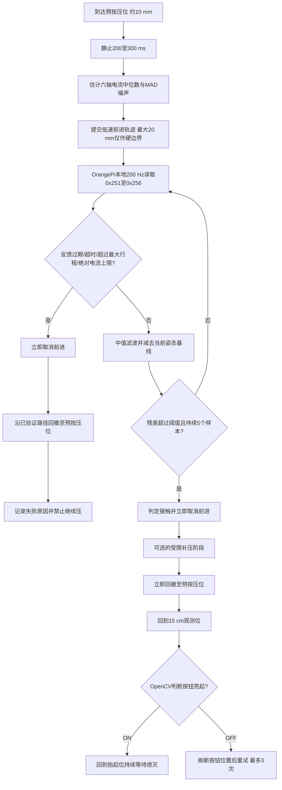

# 按钮电机电流闭环方案（2026-09-10）

## 现场结论

- `/piper_arm/joint_states` 约 500 Hz，但六个机械臂关节的 `effort` 始终为 0，不能直接使用。
- CAN `0x251..0x256` 每组约 5 ms（约 200 Hz），包含六轴电机电流。
- V2 协议中电流是数据字节 2..3 的有符号大端整数，单位 0.001 A。
- 原点静止实测约为 `[0.068, 0.408, -1.003, -0.068, -0.479, 0.028] A`，说明绝对阈值会把重力负载误判为接触。
- 当前 C++ `PiperCanComm` 已解码 `motor_current`，但公共 API 没有读取接口；硬件节点也未把它写入 arm joint effort。

## 控制闭环

“检测到接触”不等同于“按钮已电气触发”。第一版应使用两个电流等级：较低等级表示碰到按钮，进入更慢的短行程补压；较高等级立即停止。最终成功仍由按后灯光确认。

## 实现边界

`piper_handeye/guarded_press.py` 已实现 CAN 电流解码、六轴帧组装、姿态基线、MAD 噪声估计、持续接触判定、反馈过期、最大时间、最大行程和绝对电流硬停止。该模块不发送机械臂命令。

生产闭环还需要 OrangePi 本地 guarded-press 执行器。它必须与轨迹 action 在同一台 OrangePi 上运行，以便检测接触后立刻 cancel 并回撤；Jetson 通过 UDP 做 200 Hz 闭环会引入网络与调度延迟，不适合承担最后一道接触停止。

阈值不能从空载原点数据猜测。上线前应在按钮预按压姿态做三组只记录实验：静止、未接触的短距离往返、受固定小行程保护的轻触。由这些数据得到每轴 `contact_delta_a`、噪声和停止延迟后，才允许 guarded press 控制真实前进。
# 2026-09-11 实机验证更新

最终报告 `button_light_closed_loop_runs/20260911_125514/closed_loop_report.yaml`：电流闭环在 16.677 mm 检测接触，按钮 OFF→ON，约 24 秒后 ON→OFF，流程返回原点，无二次按压和视觉安全事件。最终算法在 10 mm 名义面板位置启用，使用启用前 40 个电流样本的局部运动中位数/MAD，要求 10 个持续样本。
