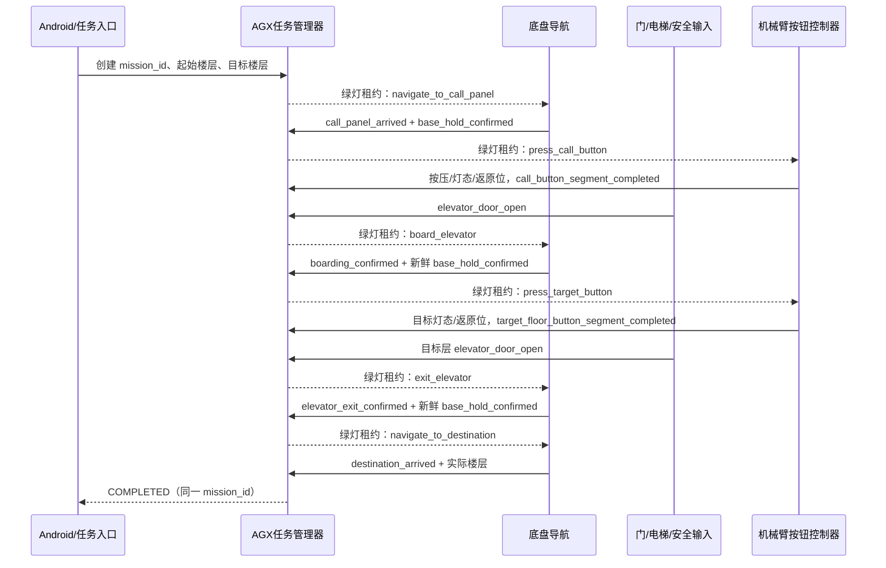

# AGX 统一任务管理与设备绿灯门控

## 目标与当前实现边界

AGX 应持有唯一 `mission_id` 和跨设备任务状态；Android/上位应用提交目标，导航底盘、机械臂与电梯/安全传感器各自报告事实状态，AGX 只在前置条件全部成立时向指定设备签发短时、单阶段的绿灯租约。设备失联、状态过期、租约过期、异常、急停或任务 ID 不一致时必须 fail-closed，不产生新的运动授权。

项目已在 `piper_handeye/mission_coordinator.py` 实现了**与硬件隔离的内存状态机原型**，覆盖状态校验、任务/设备来源校验、去重、单调序号、楼层与方向校验、阶段性绿灯、租约过期暂停、底盘停稳 freshness 和完整乘梯阶段仿真。它没有 socket/ROS 传输层，也没有接入现有 GUI、ROS 节点、Android APK 或执行桥；因此还没有给任何硬件放行。纯机械臂状态文件仍见 `ARM_MISSION_STATUS_INTERFACE_20260930.md`。

## 职责

- **AGX 任务管理器**：创建任务 ID、收集各设备报告、校验事件顺序与来源、维护全局状态、签发/撤销绿灯租约、向上层报告成功/失败。AGX 是唯一裁决者；来自设备的“完成”只是事实输入，不会自动授权下一个设备。
- **Android/操作 GUI**：提交目标楼层和取消/人工确认，显示 AGX 权威状态。Android 收包 ACK 不等于任务已接受，更不等于完成。
- **底盘导航控制器**：只执行被授权的导航动作；发布导航到点、电梯内外状态、楼层、速度/驻车、控制权和故障；丢失租约时本机 watchdog 停车。
- **机械臂按钮控制器**：只有收到本任务、此阶段的 arm permit 才可开始；报告按钮识别、按压反馈、灯态、重试、返原位及编码器验证。现有状态流含细粒度执行证据，但尚未回传 AGX。
- **电梯/门与安全输入**：报告电梯门状态、急停、碰撞/安全暂停等。底盘静止必须由底盘自身权威信号连续确认，不能由 AGX 推测。

## 绿灯顺序

其中 `call_button_segment_completed` 表示机械臂已确认呼梯灯态循环并验证返原位；`target_floor_button_segment_completed` 表示目标按键阶段结束且返原位。按钮亮灭不能替代门开或底盘到位报告。

## 绿灯租约与联锁

- permit 绑定 `mission_id + device + action + token + ttl_sec`，不能跨设备或跨阶段复用。AGX 用自己的单调时钟维护期限，远端设备按**收到 permit 时的本机单调时钟**启动 TTL/watchdog，不能比较 AGX 与设备的 monotonic 时间戳。重复请求在有效期内返回同一 token；阶段完成消费 token。
- 原型默认 permit TTL 为 2 秒，底盘停稳报告默认有效期 1 秒。长动作需定期续租；心跳超时会暂停并撤销全部 permit。每个执行板还必须有本地硬件 watchdog，租约/连接丢失时停止或保持到本地安全态，不能依赖 AGX 最后一个 UDP 包。
- 呼梯方向必须与起始/目标楼层一致；机械臂目标按钮和导航最终报告楼层必须与任务目标一致。
- 经过“驶入电梯/驶出电梯”阶段后，旧的 `elevator_door_open` 与 `base_hold_confirmed` 立即失效；机械臂绿灯与后续导航绿灯必须重新收到新鲜停稳报告。
- `FAILED / ABORTED / PAUSED` 撤销全部租约。故障恢复需要安全输入恢复并由管理器/操作员明确恢复评估；没有默认自动续跑。
- 物理急停始终高于 AGX；本地安全停止不能因管理网络故障被阻塞。

## 上线前仍缺的东西

1. **AGX 身份已通过当前主机硬件核实**：hostname 为 `ubuntu`，`/proc/device-tree/model` 报告 `NVIDIA Jetson AGX Orin Developer Kit`，`aarch64`、JetPack R36.4.7；以太网主地址为 `192.168.168.130`，`192.168.168.162` 是同一接口上的兼容别名。底盘 Jetson 仍是 `.100`，Android 屏为 `.110`，OrangePi 机械臂控制机为 `.120`。建议 AGX 管理器部署在 `.130`，保留 `.162:5005` 兼容 Android APK 网关。
2. 导航公司提供底盘报告/控制接口：导航目标 action、`base_hold_confirmed` 的定义与连续心跳、驻车/速度新鲜度、进出电梯确认、楼层权威来源、故障码、命令取消，以及本地租约 watchdog。现有 `.100` ROS master 有导航节点，但自定义消息包在开发端不完整。
3. AGX 的 `/usr/bin/python3` 已验证可导入 ROS1 `rospy`、`std_msgs`，且能只读访问 `.100:11311`；ROS graph 当前没有任务管理命名空间。确定可靠传输与身份校验（优先导航方正式 ROS action/service；可先在独立 `/youxiaomei/mission/*` namespace 做影子联调）；统一任务/设备 ID、消息版本、应用层 ACK、重传/去重、持久化恢复与时钟策略。不可把未经确认的 Android `active_result` 命令当作状态/绿灯接口。
4. 在 `.130` AGX 仿真/影子模式验收全状态与故障注入，再由导航公司共同审查权限边界，最后才接入实际 chassis/arm 执行端。本地状态 outbox 和当前手动/Android GUI 在 manager 适配器验证前维持原有路径。

因此当前可展示的是：状态契约和 AGX 裁决逻辑已在本项目内形成并可仿真验证；还不能宣称 AGX 已实际汇聚设备状态或能安全地给底盘/机械臂放行。
